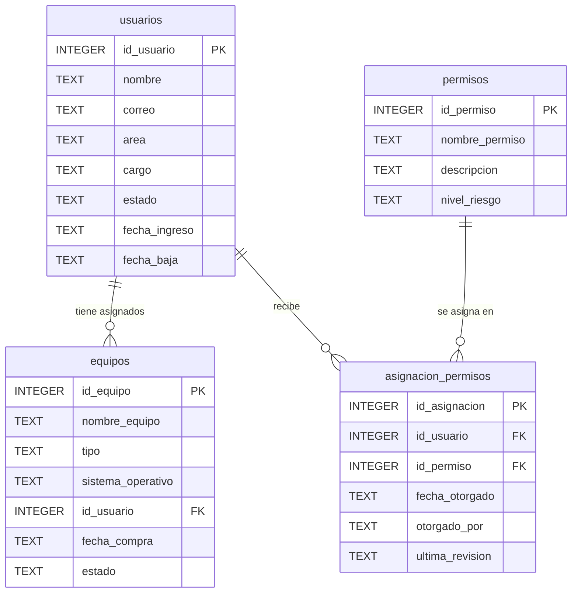
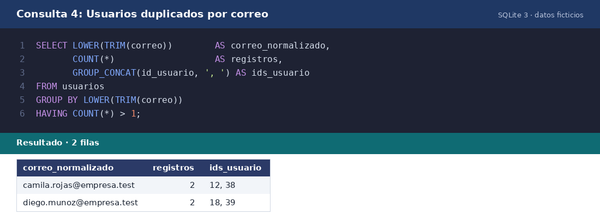
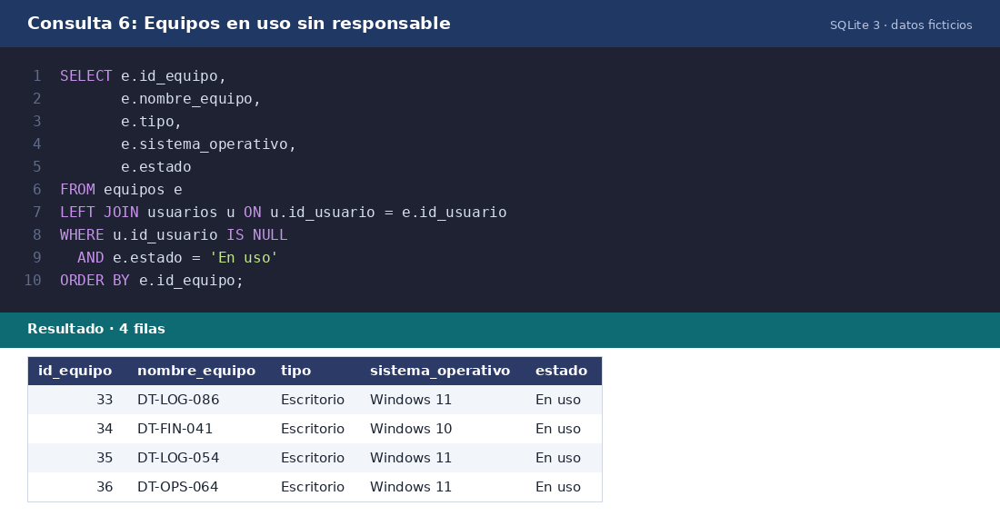
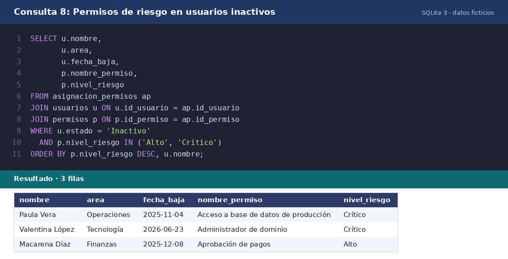
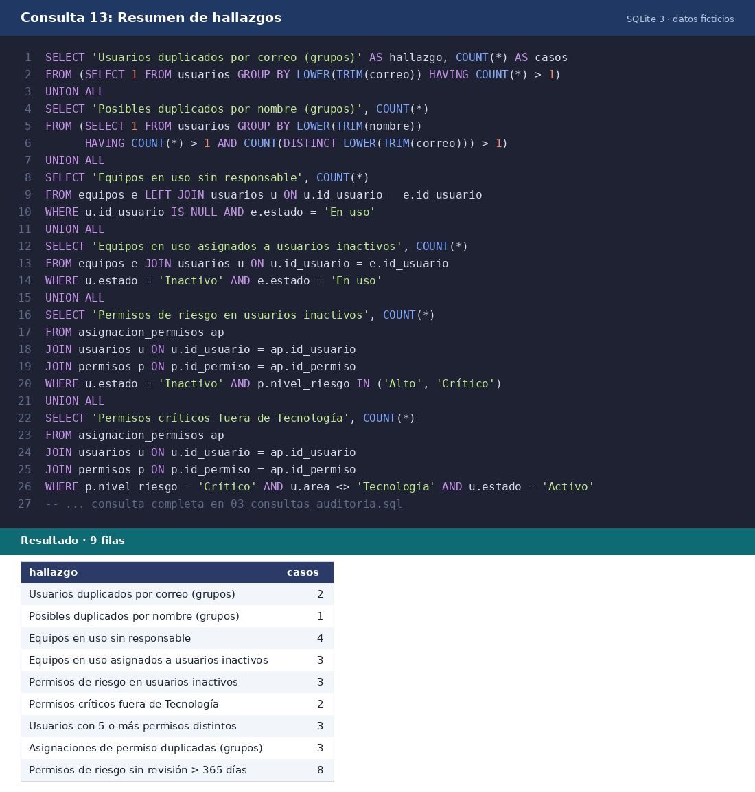

# Revisión de una base de datos con SQL: usuarios, equipos y permisos

Laboratorio práctico de auditoría TI sobre una base de datos **ficticia** de usuarios, equipos y permisos de acceso. Se consulta con `SELECT`, `JOIN` y `GROUP BY` para detectar usuarios duplicados, equipos sin asignar y permisos que necesitan revisión.

## Qué practiqué
- Crear un modelo de 4 tablas con claves foráneas y restricciones.
- Consultar los datos con `SELECT`, `JOIN` (incluido `LEFT JOIN` para encontrar registros sin pareja) y `GROUP BY` con `HAVING`.
- Detectar **usuarios duplicados**, **equipos sin responsable** y **permisos a revisar** (usuarios dados de baja, permisos críticos fuera de su área, permisos sin revisión reciente).
- Documentar cada consulta con su objetivo, resultado e interpretación.

## Contenido
| Archivo | Descripción |
|---|---|
| `01_esquema.sql` | Crea las tablas |
| `02_datos_prueba.sql` | Datos de prueba ficticios (con errores sembrados a propósito) |
| `03_consultas_auditoria.sql` | Las 13 consultas de la revisión |
| `RESULTADOS.md` | Cada consulta con su resultado, lectura y los hallazgos |
| `auditoria_ti.db` | Base SQLite ya cargada, lista para abrir |
| `capturas/` | Capturas del resultado de cada consulta |

## Modelo de datos


## Resultados (fecha de corte: 28-10-2026)
| Hallazgo | Casos |
|---|---|
| Usuarios duplicados por correo (grupos) | 2 |
| Posibles duplicados por nombre (grupos) | 1 |
| Equipos en uso sin responsable | 4 |
| Equipos en uso asignados a usuarios inactivos | 3 |
| Permisos de riesgo en usuarios inactivos | 3 |
| Permisos críticos fuera de Tecnología | 2 |
| Usuarios con 5 o más permisos distintos | 3 |
| Asignaciones de permiso duplicadas (grupos) | 3 |
| Permisos de riesgo sin revisión > 365 días | 8 |

El detalle de cada consulta y las recomendaciones están en [`RESULTADOS.md`](RESULTADOS.md).

## Cómo ejecutarlo
**Opción A (la más simple):** abre `auditoria_ti.db` con DB Browser for SQLite, ve a la pestaña *Ejecutar SQL* y pega las consultas de `03_consultas_auditoria.sql`.

**Opción B (recrear la base desde cero)** con la herramienta de línea de comandos `sqlite3`:
```
sqlite3 nueva.db
.read 01_esquema.sql
.read 02_datos_prueba.sql
.read 03_consultas_auditoria.sql
```

## Capturas
Generadas a partir de la ejecución real de cada consulta sobre `auditoria_ti.db`.






## Notas
- Todos los datos son ficticios. Los errores están sembrados a propósito para practicar su detección.
- Una alerta no es un hallazgo confirmado: en una auditoría real hay que validar con evidencia antes de reportar.
- Las consultas con fechas usan `julianday()` y `GROUP_CONCAT()`, propias de SQLite. En otros motores (MySQL, PostgreSQL, SQL Server) hay que adaptarlas.
